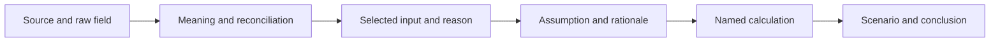

# Readiness review before the saved-analysis website

Reviewed 3 November 2026 against main `c540c56b16c666a9a78edf2b903d78cdc32a146f`. Independent storage and mapping reviews were read-only. No new acquisition, model run or valuation was performed. Storage diagnostics included SQLite integrity, foreign-key and source-hash checks; existing tests were inspected, not rerun.

## Verdict and confirmed scope

The project has a working evidence and calculation foundation. It does not yet have verified multi-company financial semantics or a general report-acquisition workflow. Proceed with validation and a saved-analysis viewer, preserving the existing valuation method.

The user confirmed ordinary operating companies first and a website that reviews saved analyses first. Analysis launch and refresh controls follow later. The existing model remains forward operating EV/EBIT scenarios with an explicit common-equity bridge; P/E and properly scoped cash yield are checks. Market-implied EBIT is a complement, not a reverse DCF. [Current scope](../planning/decisions.md#destination-and-scope), [policy, valuation methods](../analysis-policy.md#valuation-methods).

## Storage: healthy foundation, bounded operational evidence

Read-only diagnostics found:

| Store | Observation versions / current | Sources | Result |
|---|---:|---:|---|
| `data/evidence/evidence.sqlite3` | 22,593 / 22,566 | 87 | Integrity `ok`, zero foreign-key violations, all source hashes match |
| `data/granges-codex/packet-20261101/snapshot/evidence.sqlite3` | 22,593 / 22,566 | 87 | Same checks pass; database hash matches manifest |
| `data/packets/granges-generic-20261103/snapshot/evidence.sqlite3` | 22,633 / 22,606 | 88 | Same checks pass; database hash matches manifest |

The canonical database is 38,809,600 bytes. All actual financial observations belong to instrument 426; the 1,706 instrument lookup versions are not financial coverage of 1,706 companies. These results establish current file health, not concurrent-writer resilience, multi-company load or accounting correctness.

Keep SQLite for the single-user development corpus. It preserves numeric strings, source versions, units, currencies, periods and provenance, and uses a verified backup/freeze operation. PDFs/raw responses live outside SQLite; saved assumptions, calculations and answers also have separate run artifacts. Back up and restore the complete bundle. [Storage normalization and ingestion](../../betaforge/storage.py), [storage decision](../adr/0002-local-evidence-storage.md), [saved run artifacts](../codex-integration.md#cancellation-recovery-and-records), [restore procedure](../research-handoff.md#restore).

Two small improvements precede broader reliance:

- Writable initialization sets `PRAGMA user_version=1` before checking compatibility. Check the existing version before schema changes and test rejection of unsupported versions. Current version-1 databases passed diagnostics. [EvidenceStore initialization](../../betaforge/storage.py#L113).
- Distinguish financial period, publication date, first capture, last successful check and frozen cutoff. Current queries return immutable observation records; their first-seen timestamps alone do not describe later unchanged refreshes. [Observation persistence and queries](../../betaforge/storage.py#L171).

Serialize ingestion, retain versioned backups and periodically verify restore. A server database is not justified by the present workload; this is an engineering recommendation, not a measured capacity result.

## Mappings: selected Gränges inputs, not universal definitions

The initial review maps 37 observed report fields in FY2025/Q3 2026 samples. Later work preserves 82 reconciled facts and 40 quality facts. That supports selected Gränges inputs, not uniform provider semantics across all issuers and years. [Initial field map](../../examples/granges/docs/research/granges-borsdata-mapping.md), [selected-input resolution](../../examples/granges/docs/research/granges-mapping-resolution.md), [validation scope](../../examples/granges/docs/research/simple-framework-implementation-validation.md).

Concrete traps already found include `gross_Income` matching sales less materials rather than ordinary gross profit; provider FCF matching CFO plus total investing cash flow; share/EPS denominator differences; and historical net-debt basis changes. Numeric agreement must remain separate from verified accounting meaning. [Income and cash fields](../../examples/granges/docs/research/granges-borsdata-mapping.md#complete-saved-report-field-map), [historical debt findings](../../examples/granges/docs/research/granges-mapping-resolution.md#findings-added-by-the-completed-walkthrough).

Implement the already specified mapping record: provider field/version, canonical concept, scope and conventions, applicable issuer/periods, definition status, numeric reconciliation/residual, evidence and selected-input reason. Do not build another mapping platform. Validate material valuation inputs for three to five different operating businesses. Optional gaps remain visible; use sourced report substitutions or explicit assumptions rather than blocking the whole analysis. [Mapping contract and acceptance checks](borsdata-retrieval-storage.md#mapping-provider-fields-to-report-figures), [conditional analysis policy](../analysis-policy.md#investment-philosophy).

General report discovery/OCR and another real-company end-to-end walkthrough remain unverified. The current Gränges set has five annuals and three subsequent interims, not the full five-year interim archive specified for retention. Before expanding the archive, separate stored reports from mandatory reading: the current builder selects every indexed report as required. [Scope](../../README.md), [retention requirements](borsdata-retrieval-storage.md), [packet preparation](../../scripts/prepare_codex_packet.py).

## Transparent decisions and the first website

Reuse frozen packets and existing input/calculation/run records. Add only the missing structured rationale needed to connect them:

For each material choice, retain the value/basis, evidence IDs and report pages, explanation, relevant alternative, uncertainty and what would change the choice. Forecast earnings, exit multiples, retained cash, dilution and probabilities need reasons; arithmetic provenance alone does not explain them. Keep facts, interpretations and assumptions distinguishable. [Output discipline](../analysis-policy.md#output-and-calculation-discipline), [formula catalogue](../calculations.md).

The proposed viewer should offer a concise thesis and three to five earnings drivers; consistent financial history; side-by-side Börsdata/report reconciliation; scenario assumptions and probabilities; an EV-to-equity bridge; and clickable formulas, inputs and original report pages. Show future targets separately from present values. Useful first charts are earnings/cash history, the equity bridge and modest downside sensitivity. Opening a saved analysis performs no acquisition or model run. This is a proposed interface, not implemented functionality. [Existing saved artifacts](../codex-integration.md#cancellation-recovery-and-records).

## Frozen development corpus and priorities

A frozen corpus can support most remaining mapping, calculation and interface development. Start with ten representative issuers, reconcile three to five deeply and expand toward thirty only for useful coverage. Save all available agreed dataset families, definitions, raw responses, original/readable reports, actual coverage, gaps, dates, hashes and versions. Current historical data can contain restatements; it is not automatically a point-in-time backtest. Fresh/revised-data ingestion and current-price valuations still need live checks. Post-cancellation reuse rights are not established by the reviewed public terms. [Detailed feasibility and source research](frozen-dataset-feasibility.md).

Recommended implementation order, pending agreement:

1. Fix the schema-version guard and expose freshness/coverage metadata.
2. Establish the material-input mapping/selection record and verify another real issuer, then three to five diverse operating companies.
3. Complete the saved decision record and build the read-only local viewer over existing artifacts.
4. Broaden the frozen regression corpus; add launch/refresh controls after saved-result review is trustworthy.

The model does not need more valuation formulas before these steps. The missing evidence concerns portability across businesses, input meaning and visible decision rationale.
